# Kâşif


**Ask your database in Turkish. See exactly how the answer was found.**

Kâşif turns a plain-language question such as *"Geçen çeyrekte bölgelere göre ciro"* (revenue by region last quarter) into SQL, runs it on a **read-only, validated** connection, and returns a chart, a sortable table and a short written summary. It also shows **how it understood the question**, live, while you type: every word is underlined in the color of what it became (measure, breakdown, period, filter, ranking), and words it does not know get a red wavy line before you even press Enter.

It works **without an LLM**. A rule engine built on a *semantic layer* handles everyday analytics questions deterministically. When a local or hosted LLM is connected, it also answers free-form questions. The SQL the model writes goes through the same safety checks, and if a query fails, the model sees the error and fixes its own query.

> *Kâşif* is Turkish for "explorer".

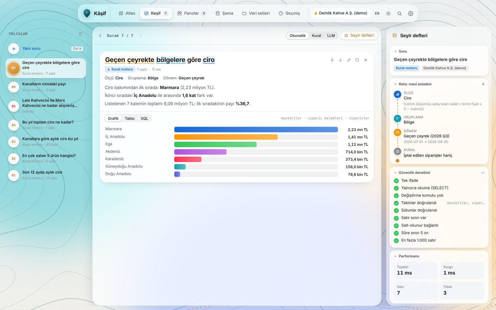

> 🇹🇷 **Türkçe özet:** Veritabanına Türkçe soru sorup cevap alan bir analiz asistanı. Soruyu ölçü, boyut, dönem ve filtrelere ayırır, güvenli bir SQL'e çevirir, salt-okunur çalıştırır ve sonucu grafik, tablo ve özetle sunar. Nasıl anladığını adım adım gösterir. Siz yazarken her kelimeyi neye dönüştürdüğünü renkli altı çizgilerle canlı gösterir. Anlamadığı soruda tahmin yürütmez, kullanıcıya sorar. LLM olmadan da çalışır; bağlıysa serbest soruları da yanıtlar ve hatalı SQL'ini kendisi düzeltir. Kendi CSV ya da SQLite dosyanızı yükleyebilirsiniz.

## Why

"Talk to your data" is one of the most requested AI features in companies, and also one of the riskiest. A model that writes SQL can produce queries that look plausible but are wrong, touch tables it shouldn't, or try to modify data. Kâşif treats these problems as first-class design goals:

| Problem | What Kâşif does |
|---|---|
| A wrong but plausible number | Business terms (*ciro*, *brüt kâr*, *ortalama sepet*) are defined **once** in a semantic layer, so the rule engine never improvises a formula. Every step of the interpretation is shown. |
| Guessing when unsure | If a question contains words the engine cannot map, it **refuses to guess**, says which words it didn't understand and offers to run only what it did understand. |
| Dangerous SQL | Every query, whether from the rule engine, the LLM or the user, is parsed and checked: one statement, SELECT only, known tables and columns, no file/extension functions, LIMIT enforced. It then runs on a read-only connection with a time limit. |
| LLM mistakes | Unknown columns or failing queries are sent back to the model **once** with the exact error, and it fixes the query. Attempts to modify data are never retried. |
| Summaries that drift from the data | The written summary is **computed from the result rows**, not written by a model, so the text can never contradict the table. |

| LLM fixes its own query *(simulated model responses)* | Refusing to guess |
|---|---|
| 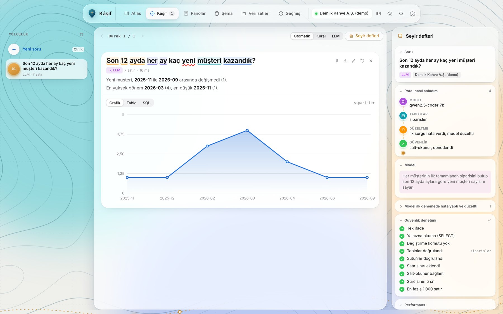 | 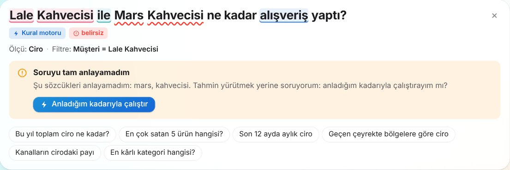 |

## Design

The interface is an expedition atlas in layers rather than one crowded screen. A floating *liquid glass* dock moves between them, and the topographic map behind zooms in as you go deeper. It is built around one idea: **an analyst should see what the machine understood before trusting the number.**

| Layer | |
|---|---|
| **Atlas** | The open map: a "you are here" pin, the question bar, suggested routes, a *map legend* (dataset, LLM status, tables), the last stops to pick up where you left off, and one-click theme and language switches. |
| **Explore (Journey)** | Every question becomes a numbered stop on a dashed route on the left. One answer is shown at a time, large, with previous / next. The **Logbook** on the right holds the question, a *Route: how I understood it* trail (measure → breakdown → period → filters → rules, or model → tables → fix for LLM answers), a **security checklist** that ticks every guard check that actually passed (single statement, SELECT only, no writes, known tables, known columns, LIMIT, read-only connection, time limit), timings and the SQL. On narrow screens it becomes a drawer. |
| **Boards · Datasets · History** | Full-width glass pages. Pinned answers are widgets that re-run their SQL with fresh data every time a board opens. |
| **Schema (Terrain)** | The ER diagram is laid directly on the map: tables float as glass islands, foreign keys are drawn as routes. |
| **Compass (`Ctrl+K` / `⌘K`)** | A command layer available everywhere. As you type, the `/parse` endpoint returns character spans and each word is underlined live: measure blue, breakdown teal, period orange, filter pink, ranking purple, unknown **red wavy**. The same coloring stays on the answer's title. |
| **Map** | Contour lines generated with marching squares, a latitude/longitude grid and an animated route; a morning-chart light theme and a night-chart dark theme. While a query runs, the pin hops and its rings pulse faster. |

| Atlas | Journey + Logbook |
|---|---|
| 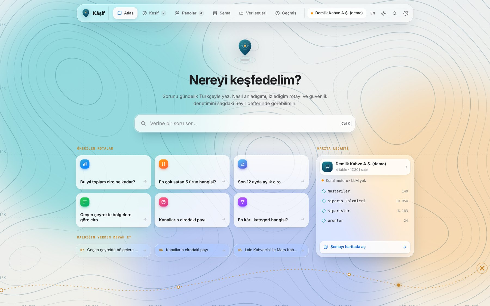 |  |

| Compass with live understanding | Schema on the map |
|---|---|
| 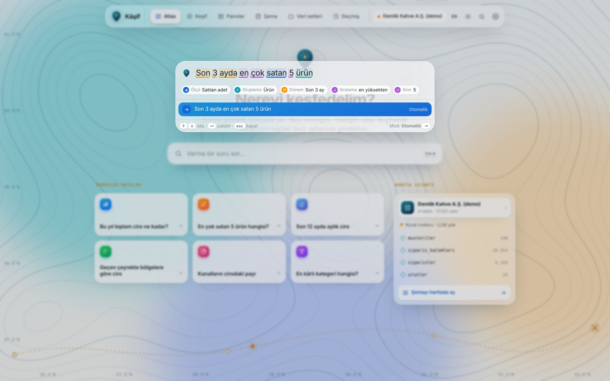 | 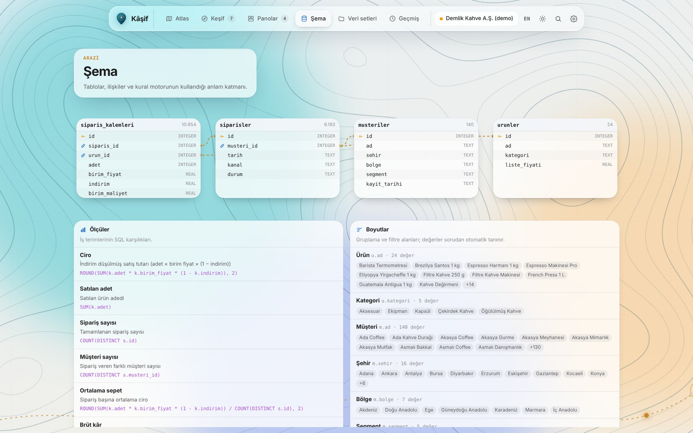 |

## Features

| | |
|---|---|
| **Answers** | Plan, a computed summary, and Chart / Table / SQL tabs. Charts are picked automatically: KPI, bar, line, multi-series line, donut. |
| **Turkish understanding** | Relative dates (*geçen çeyrek*, *son 3 ay*, *Ekim 2025*, *yılbaşından beri*), rankings (*en çok satan 5 ürün*, *en az*), comparisons (*Ankara ve İzmir*), exclusions (*İstanbul hariç*), shares (*Web kanalının payı*), year-over-year comparisons on the **same date range** (*bu yıl geçen yıla göre*) and Turkish suffixes (*İzmir'deki kafelerin*). Basic English works too. |
| **Follow-ups** | Each answer suggests next questions: a time breakdown, a drill-down into the top item (*Marmara → cities*), or a related measure. Every suggestion is validated by the parser before it is shown. |
| **Schema** | An ER diagram with foreign-key links, sample rows per table, and the full semantic layer: every measure's SQL and every dimension's values. |
| **Bring your own data** | Upload a CSV or SQLite file. Turkish CSVs from Excel just work: `;` separators, Windows-1254 encoding, `1.234,56` numbers and `31.12.2025` dates. A semantic layer is generated automatically, so the rule engine answers questions on your data too. |
| **SQL editor** | Edit any generated query and run it; the same safety checks apply. |
| **History** | Every question with its method (rules / LLM / SQL), row count and duration. |
| **Everything else** | CSV export (Excel-friendly), light and dark themes, Turkish and English, keyboard shortcuts, drag-and-drop upload, mobile layout. The UI is a single dependency-free HTML file. |

| Boards | Your own CSV |
|---|---|
| 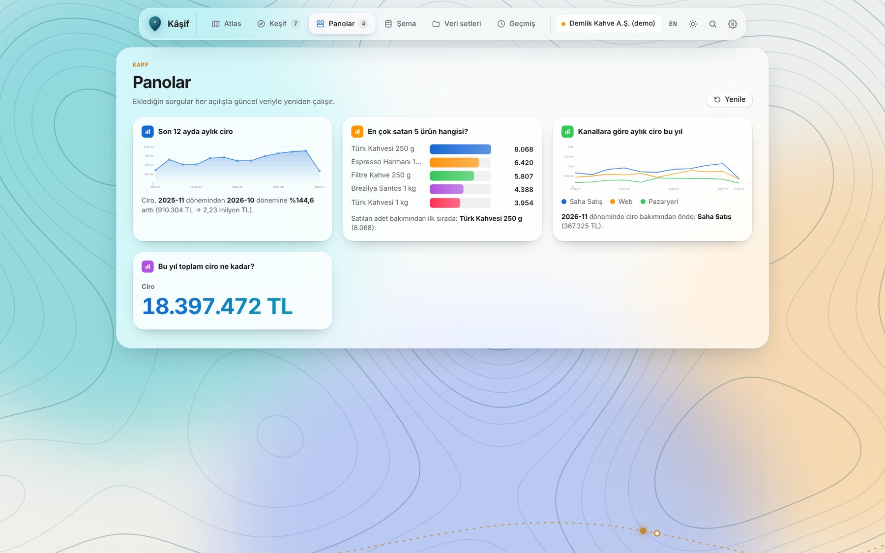 | 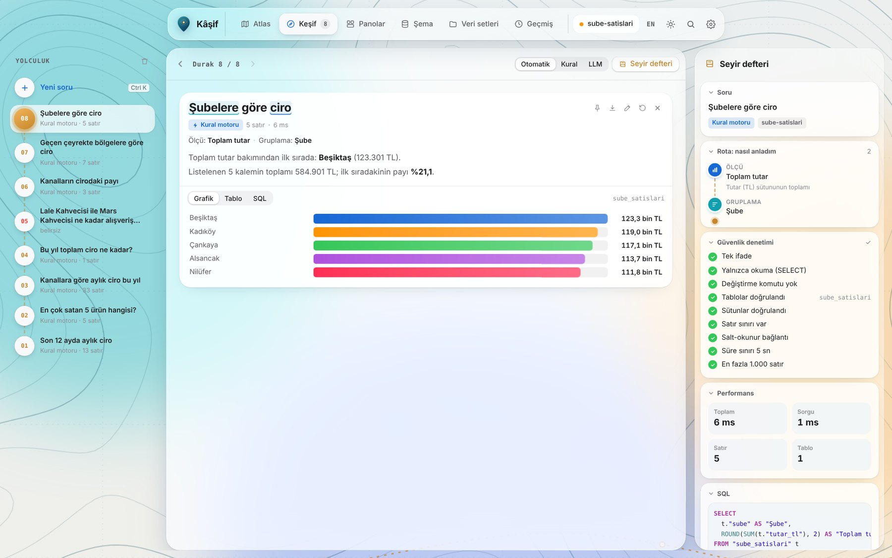 |

| History | Settings |
|---|---|
| 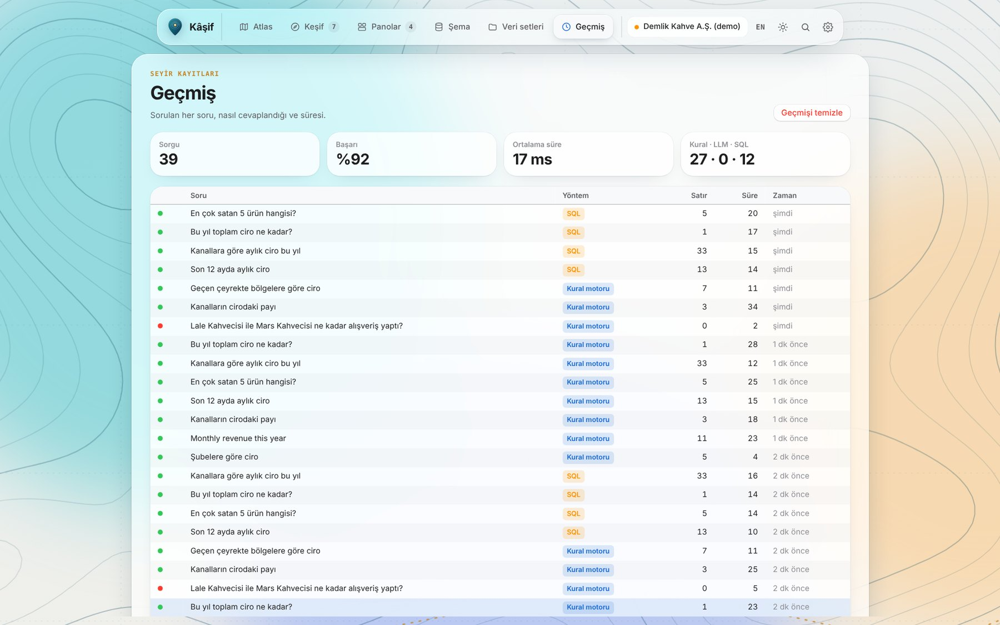 | 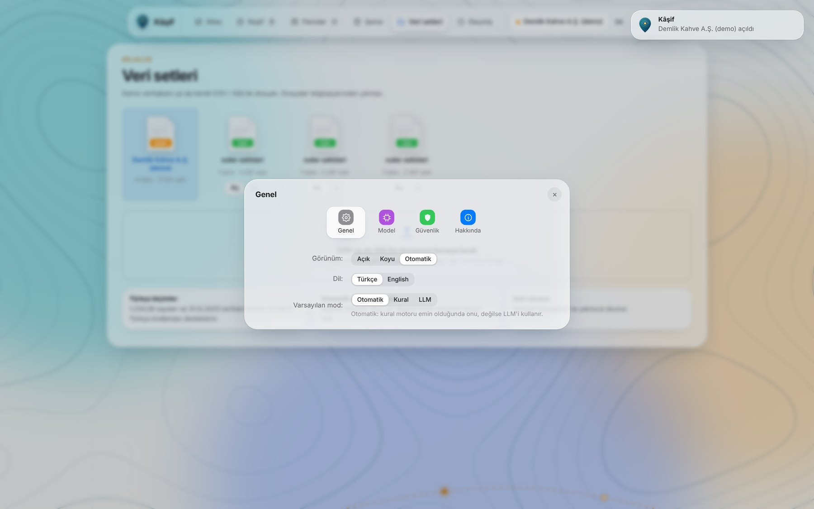 |

| Dark mode | Mobile |
|---|---|
| 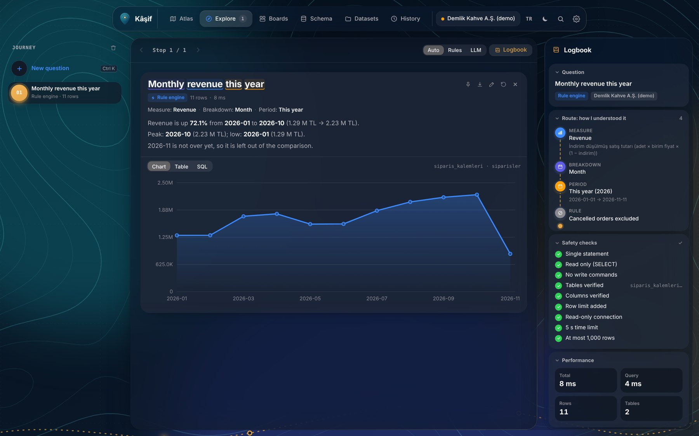 | 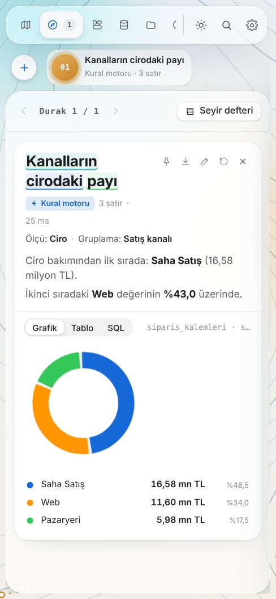 |

## How it works

```
 question ─► parser ──────────────► plan ─► SQL builder ─┐
   │         (semantic layer)        │                   │
   │                                 └─ unknown words? ──┼─► LLM (optional) ─┐
   │                                                     │                   │
   │                                                     ▼                   ▼
   │                                              guard: parse & validate ◄── retry once with the error
   │                                                     │
   │                                                     ▼
   │                                   read-only SQLite, time limit, row cap
   │                                                     │
   └──────────────► answer: plan · chart · table · SQL · summary computed from rows · follow-ups
```

**1. Semantic layer** (`semantic.py`). Business terms are mapped to SQL once:

```python
Metric("ciro", "Ciro", "ROUND(SUM(k.adet * k.birim_fiyat * (1 - k.indirim)), 2)", "money",
       ["ciro", "gelir", "hasılat", "satış tutarı", "satış", ...])
Dimension("bolge", "Bölge", "m.bolge", ["bölge", "region"], needs=("m",))
# global rule: cancelled orders are excluded from every sales measure
```

**2. Parser** (`parser.py`). Tokenises with Turkish-aware lowercasing (`I → ı`, `İ → i`), finds time expressions, then places measure, dimension and **value** matches longest-first (dimension values such as *İzmir*, *Kafe* or *Türk Kahvesi* are read from the database). Suffix-tolerant matching handles *kafelerin*, *bölgelere*, *ürününden*. Context rules handle phrases like *"Web kanalında"* (a filter, not a grouping) and *"Ekipman satışlarından elde edilen kâr"* (profit, not revenue).

**3. Guard** (`guard.py`). Built on [sqlglot](https://github.com/tobymao/sqlglot): single statement, `SELECT`/`WITH`/`UNION` only, no `INSERT`/`UPDATE`/`DELETE`/`DROP`/`ATTACH`/`PRAGMA`, no `load_extension`/`readfile`/…, no `sqlite_master`, column resolution against the real schema, and a `LIMIT` is added if missing.

**4. Executor** (`execute.py`). `file:…?mode=ro` connection with `PRAGMA query_only`, a progress handler that aborts after the time limit (5 s by default), and a row cap (1000 by default).

| Decision | Why |
|---|---|
| **Rule engine first, LLM second** | Deterministic, instant, free and explainable for the questions people ask most. The LLM handles the long tail. |
| **Refuse rather than guess** | A confident wrong number is worse than "I didn't understand *maaş*". The user can still run the partial interpretation with one click. |
| **Defence in depth** | Validation and a read-only connection protect against different failures. Either one alone would be too weak. |
| **Summary from data** | Numbers in the text are computed from the result, so the text can't contradict the table. |
| **Same-period comparison** | "This year vs last year" in November compares Jan 1 – Nov 10 of both years, not a partial year against a full one. Unfinished months are left out of trend comparisons. |
| **Provider-agnostic LLM** | Any OpenAI-compatible endpoint: local Ollama (default, `qwen2.5-coder:7b`), OpenAI, Groq and others. |

## Quick start

You need Python 3.11+.

**Windows:** double-click `start.bat`.
**macOS / Linux:** `./start.sh`

The first run creates a virtual environment and installs dependencies. The browser then opens at `http://127.0.0.1:8200`. If the port is busy, the next free one is used. The demo database (*Demlik Kahve A.Ş.*, a fictional coffee roaster and wholesaler with ~6,000 orders since 2024) is generated automatically and refreshed daily, so questions like *"bu ay"* (this month) always have data.

```bash
# manual
python -m venv .venv && . .venv/bin/activate     # Windows: .venv\Scripts\activate
pip install -e ".[dev]"
python -m kasif.serve

# command line
kasif ask "Geçen çeyrekte bölgelere göre ciro"
kasif sql "SELECT segment, COUNT(*) FROM musteriler GROUP BY 1"

# Docker
docker build -t kasif . && docker run -p 8200:8200 -v kasif-data:/data kasif
```

### Optional: connect an LLM

Install [Ollama](https://ollama.com), then:

```bash
ollama pull qwen2.5-coder:7b
```

Restart Kâşif and the status light turns green. To use another provider, copy `.env.example` to `.env` and set `KASIF_LLM_BASE_URL`, `KASIF_LLM_API_KEY` and `KASIF_LLM_MODEL`.

### Your own data

Drop a file onto the window or use **Datasets**. Try `samples/sube-satislari.csv`, a café chain's sales exported from Excel with Turkish formats, and ask *"Şubelere göre ciro"*, *"En çok satan 3 ürün"* or *"Ekim ayında Kadıköy şubesinin toplam tutarı"*.

## API

Interactive docs are served at `/docs`.

| Method | Path | Description |
|---|---|---|
| `POST` | `/ask` | `{"question": "...", "mode": "auto" \| "rules" \| "llm", "lang": "tr" \| "en"}` → plan, SQL, columns, rows, chart, summary, follow-ups, LLM attempts, `tokens` and the passed security `checks` |
| `POST` | `/parse` | `{"question": "..."}` → live preview: understood / confident, plan steps, unknown words and `tokens` (`{"s", "e", "k"}` character spans by kind) used for the colored underlines |
| `POST` | `/sql` | `{"sql": "SELECT ..."}`: run validated, read-only SQL |
| `GET` | `/schema` | Tables, columns, foreign keys, sample rows and the semantic layer |
| `GET` | `/examples` | Example questions for the active dataset |
| `GET` · `POST` | `/datasets` | List datasets / upload a CSV or SQLite file |
| `POST` · `DELETE` | `/datasets/{id}/activate` · `/datasets/{id}` | Switch / delete |
| `GET` · `DELETE` | `/history` | Query log / clear it |
| `GET` | `/status` | Active dataset, LLM connectivity, limits, usage stats |

## Evaluation

`evals/run_eval.py` measures **execution accuracy**. Each question has a hand-written gold SQL query. Both queries run on the same database, and the result sets are compared ignoring row order and column names, with numbers rounded. Questions whose answer is not in the data must be **declined**.

```bash
python evals/run_eval.py --set questions   # development set
python evals/run_eval.py --set holdout     # held-out set
```

Rule engine, no LLM:

| Set | Questions | Execution accuracy | Correctly declined |
|---|---|---|---|
| Development | 37 | 100% (37/37) | 5/5 |
| Held-out, **first run** | 16 | **75% (12/16)** | 3/3 |
| Held-out, after fixes | 16 | 100% (16/16) | 3/3 |

**Read this honestly.** The parser was tuned on the development set, so 100% there says little. The held-out set was written afterwards with new phrasings; its **first run scored 75%**. The four failures were *"daha çok"* (more), a possessive suffix (*ürününden*), *"Ofis müşterilerinin"* (customers of the office segment) and *"satışlarından elde edilen kâr"*. The fixes were general rules, not special cases, but the held-out set has now influenced the code and is no longer truly held out. A fresh held-out set, and LLM-mode results on a larger benchmark, are on the roadmap. Both sets run in CI on every push.

## Limitations

- The rule engine covers aggregate questions: totals, rankings, trends, shares and comparisons. Questions such as *"customers who haven't ordered in 90 days"* or cohort analysis need the LLM.
- Auto-generated semantic layers for uploaded files cover the largest table only; joins across uploaded tables are left to the LLM.
- Only SQLite (and CSV converted to SQLite) is supported. The guard and executor are written so that other dialects could be added.
- The demo data is synthetic, and all names in it are fictional.

## Tests

```bash
pytest -q          # 54 tests: parser, guard, engine, LLM self-correction (fake model), uploads, API, eval
ruff check src tests evals && ruff format --check src tests evals
```

CI runs on Windows, macOS and Linux with Python 3.11 and 3.13.

## Project structure

```
src/kasif/
  semantic.py   business terms → SQL (hand-written for the demo, inferred for uploads)
  parser.py     Turkish question → plan → SQL, plus the plan explanation
  guard.py      SQL validation (sqlglot)
  execute.py    read-only execution with time and row limits
  insights.py   chart choice and data-computed summaries
  engine.py     orchestration: rules vs LLM, self-correction, follow-ups
  datasets.py   demo + CSV/SQLite uploads (Turkish formats)
  demo.py       deterministic synthetic database
  api.py        FastAPI · static/index.html: the UI
evals/          gold-SQL question sets and the evaluation script
```

## Roadmap

- [ ] Fresh held-out set and LLM-mode benchmark
- [ ] PostgreSQL / DuckDB connections
- [ ] Semantic layer editor in the UI (add synonyms and measures without code)
- [ ] Multi-table semantic layers for uploaded databases
- [ ] Scheduled board snapshots

## Author

**Numan AK**, Computer Engineering, Sakarya University
[GitHub](https://github.com/numanak-b221210105) · [LinkedIn](https://www.linkedin.com/in/numan-ak-b93555210)

Licensed under the [MIT License](LICENSE).
